<div align="center">


<br />

<a href="https://github.com/exodux-dev/NexisOverlay/releases/latest"></a>
<a href="https://ko-fi.com/exoduxdev"></a>


<br />

<a href="docs/trailer/nexis-trailer.mp4"></a>

<sub>▶ <a href="docs/trailer/nexis-trailer.mp4">Watch the full trailer</a> (33 s, with sound)</sub>

</div>


## Why Nexis



## Highlights


<p align="center"><b>Everything for your next game, in one window</b><br /><sub>Build, runes, skill order and what to buy right now, from real match stats, next to the League client or over the game.</sub></p>

<details>
<summary></summary>

<br />

<p align="center"><br /><b>A calm in-game HUD</b><br /><sub>Next buy, skills and augments; it fades while you play, with a level-up arrow on League's own ability bar.</sub></p>

<p align="center"><br /><b>Augment tier badges, in game</b><br /><sub>A grade, win rate and pick rate under each augment card, ranked for your champion.</sub></p>

<p align="center">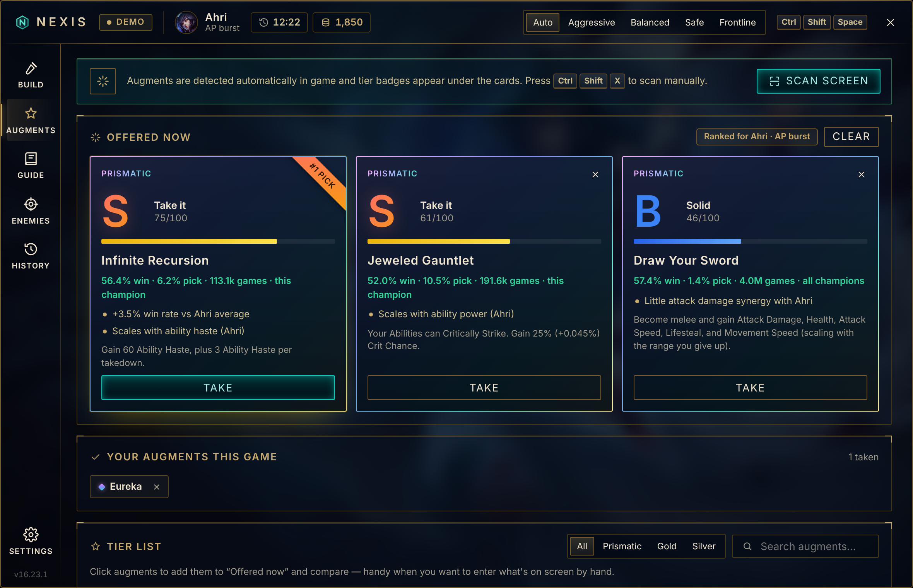<br /><b>Augments for your champion</b><br /><sub>Per-champion rankings for ARAM: Mayhem and Arena, combos and reroll advice.</sub></p>

<p align="center">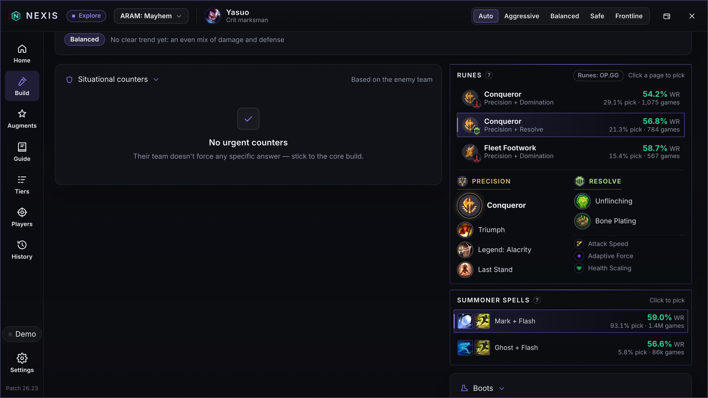<br /><b>Runes</b><br /><sub>Every rune page with win rate, pick rate and games, laid out like League's rune screen.</sub></p>

<p align="center"><br /><b>Champ select that helps</b><br /><sub>Bench and teammate picks compared by win rate, plus a team comp breakdown.</sub></p>

<p align="center"><br /><b>Know the lobby</b><br /><sub>Scouting for all 10 players and a live team-power comparison.</sub></p>

<p align="center">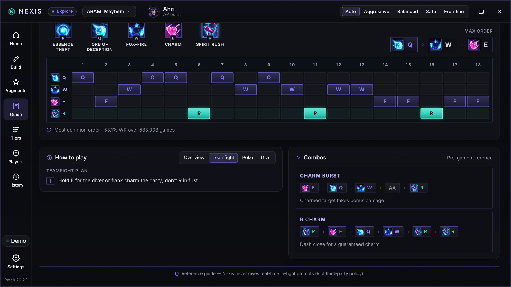<br /><b>Guides</b><br /><sub>Skill order, combos and a plan for every kind of fight.</sub></p>

<p align="center">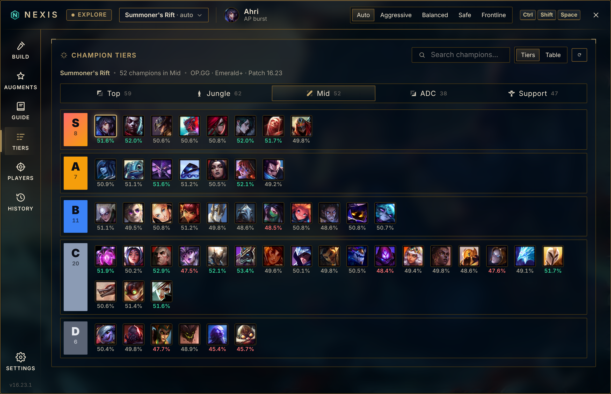<br /><b>Tier lists</b><br /><sub>S–D tiers for every mode and role.</sub></p>

<p align="center">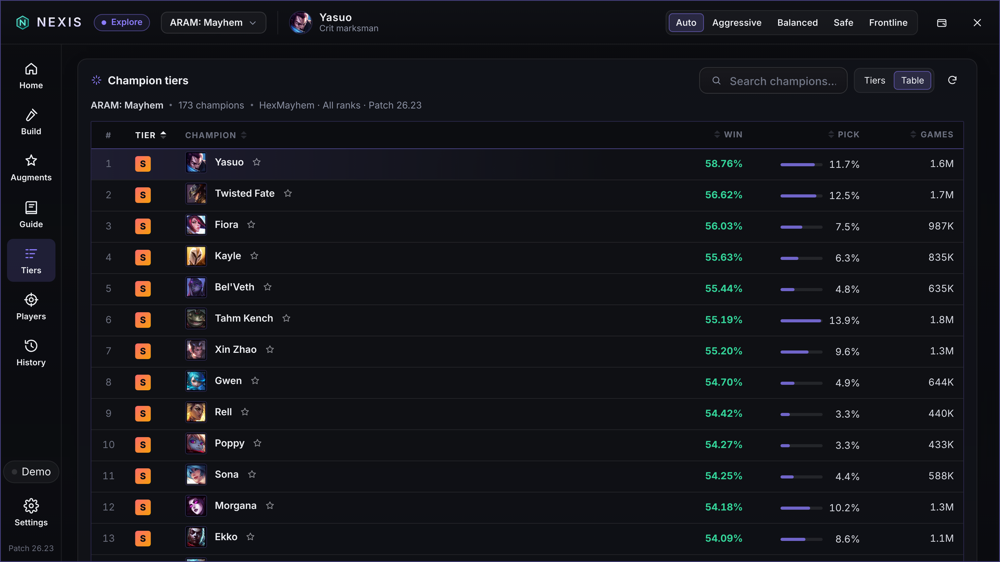<br /><b>Tier table</b><br /><sub>The same tiers as a sortable table.</sub></p>

<p align="center">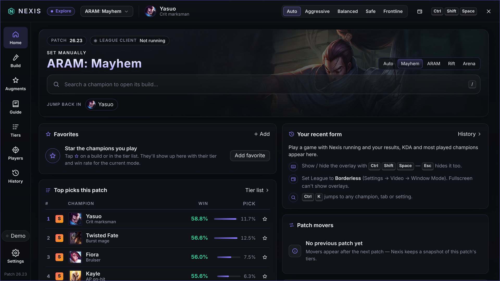<br /><b>Home</b><br /><sub>Your favorites, recent form, top picks and patch changes for you.</sub></p>

<p align="center">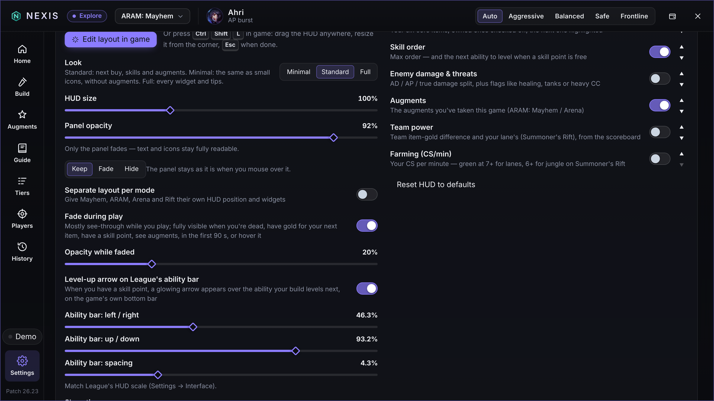<br /><b>Make the HUD yours</b><br /><sub>Pick what the HUD shows, how much it fades and where the level-up arrow sits.</sub></p>

</details>


## Features

**Builds that adapt**
- The most played core build per champion, mode and role (as the stats sites list it), with u.gg-style options: rune pages, summoner spells, core builds (including the highest win-rate one), starting items and boots, each with win rate, pick rate and games.
- **Pick the data source** per mode (HexMayhem, OP.GG, your own games, your Riot dataset or the baseline) and your **role** on the Rift.
- **Share a build** with a short code a friend pastes into Nexis.
- Situational counters for the enemy team: anti-heal against healers, penetration against tanks, MR or armor against the damage you face.
- **Shop now:** what to buy with your current gold, what to save for and how far you are, plus tips for the game phase.
- Build styles such as Full AP / Full AD Varus or Red / Blue Kayn.
- Hover tooltips for every item, ability, rune, stat shard, summoner spell and augment.
- ARAM: Mayhem runes from OP.GG's Mayhem rune pages (HexMayhem has none).
- Optional **Import to League:** saves your chosen rune page and item set to the client (off by default; only ever replaces entries named *Nexis:*).

**Always-on mini HUD**


- A compact panel in game. The default (Standard) look shows only your next buy, what you're saving for, your skills and your augments. Core build, enemy damage, team gold, tips and CS/min are one switch away (or pick the Full look).
- **Fades during play:** mostly see-through while you play, fully visible when you're dead, can afford your next item, have a skill point or augments are on screen (opacity is adjustable).
- **Level-up arrow** on League's own ability bar over the ability to level next (line it up once in Settings).
- **CS per minute** (optional), colored against a target for your role on Summoner's Rift.
- Drag and resize it anywhere (Ctrl+Shift+L); toggle, reorder or collapse each widget; fade or hide it when your mouse is over it.
- **Shop view while dead:** opens up with the shop first and your respawn time.
- **Augment badges** appear about half a second after the cards, above them; your pick is detected from the screen ("✓ Picked") and a short reminder covers the rest.
- Optional power spike line: your next item spike and enemies close to finishing an item.
- Minimal / Standard / Full looks and a separate layout per mode.
- Never takes focus from the game, and clicks always pass through.

**Champ select & loading screen**
- Teammate scouting (when the queue shows names), **your best picks** from your own games for this team, duo partners (Arena, Rift bot lane).
- Loading-screen **game plan**: win condition, first power spike, the threat to respect.
- Summoner's Rift **roles**: fix swapped lanes with two clicks; lanes, matchups and your build follow.

**After the game**
- Post-game summary with your build vs the recommended one, and a shareable recap image.
- Game timeline: item timings, an item-gold chart against both teams, CS/min and KDA trends.
- Match history with win-rate trends, per-champion stats (win rate, KDA, CS/min, CS at 10), CSV / spreadsheet export and backup / import.

**Polished app**
- Home dashboard: favorites, recent form, top picks, **patch changes for you** and **grow your pool** suggestions.
- Champion search that understands short names and typos (yas, tahm, mf, j4, yasou).
- English, Español and Português; streamer mode; optional Discord status; update check with what's new.
- Auto-detects ARAM: Mayhem, ARAM, Arena and Summoner's Rift from your queue (or pick one manually).
- Themes (new graphite + violet default, Classic League look), accent color, UI scale, window size presets, Ctrl+K command palette, tray menu, start hidden, launch with Windows.
- Settings → Diagnostics: live status of every component, an event log and a one-click report for bug reports.


## Install


1. Download **NexisOverlay-portable** from the latest [Build](../../actions/workflows/build.yml) run (or Releases) and unzip it anywhere.
2. Run `Nexis Overlay.exe`. It lives in the system tray.
3. In League, set **Video → Window Mode → Borderless** (overlays can't draw over exclusive fullscreen).

Nexis is fully portable: settings, history and caches stay in a `data` folder next to the exe. To move it, move the folder; to remove it, quit from the tray and delete the folder.

| Hotkey | Action |
| --- | --- |
| **Ctrl+Shift+Space** | Open / close the overlay |
| **Ctrl+Shift+H** | Show / hide the in-game mini HUD |
| **Ctrl+Shift+L** | Move and resize the mini HUD |
| **Ctrl+Shift+X** | Scan the screen for augments now |
| **Ctrl+K** | Command palette |

Every hotkey can be rebound in **Settings → Hotkeys**; the recorder warns about clashes with NVIDIA, Xbox Game Bar, Steam, Discord and League's own binds.


## Fair play


See [SECURITY.md](SECURITY.md) for exactly what Nexis accesses. Nexis isn't endorsed by Riot Games; as with any third-party tool, use it at your own discretion.


## Data sources

| Mode | Source |
| --- | --- |
| ARAM: Mayhem | [HexMayhem](https://hexmayhem.com): per-champion augments, builds, skill orders |
| ARAM, Summoner's Rift | [OP.GG](https://op.gg): builds, items, runes, spells, counters (per role on the Rift) |
| Arena | [OP.GG](https://op.gg) Arena stats + [CommunityDragon](https://communitydragon.org) augment catalogue |
| Duo partners | [OP.GG](https://op.gg) synergies (Arena, Summoner's Rift) |
| Static data | Riot [Data Dragon](https://developer.riotgames.com/docs/lol#data-dragon) (updates automatically each patch) |

Pages are cached and refreshed every few hours; old cache files are cleaned up automatically. You can also point Nexis at your own dataset built from the Riot API ([docs/STATS.md](docs/STATS.md)). None of these sites are affiliated with Nexis; credit for the data goes to them.


## Development

<details>
<summary><b>Build from source</b></summary>

Requirements: Node 22+, Rust (stable) and the WebView2 runtime (preinstalled on Windows 10/11).

```bash
npm install
```

| Command | What it does |
| --- | --- |
| `npm run dev` | UI only, in the browser, with hot reload |
| `npm run app:dev` | Full desktop app |
| `npm run mock:game -- --end-after 90` | Fake League game for testing |
| `npm test` | Unit tests (engine + stats aggregator) |
| `npm run e2e` | End-to-end smoke tests (Playwright, offline fixtures) |
| `npm run app:build` | Portable release build |

CI builds the portable app and runs type-checks, unit tests and end-to-end tests on every push.

</details>

<details>
<summary><b>Architecture</b></summary>

```
src-tauri/src/      Rust backend (read-only towards the game)
  live.rs           Live Client Data API + League client polling
  lcu.rs            League client lockfile / champ-select session
  league_import.rs  opt-in rune page + item set import
  capture.rs        augment-region screenshot + Windows OCR
  hud.rs, window.rs overlay windows, click-through HUD, placement
  store.rs          portable storage, caching, backups
src/engine/         recommendation engine (pure TypeScript, unit-tested)
src/data/           champion, item, guide and stack-goal knowledge
src/app/store.ts    app state + backend wiring
src/views, src/ui   React UI
e2e/                Playwright smoke tests
scripts/            Riot API stats aggregator, mock game server
```

</details>


## Contributing

Issues and pull requests are welcome. Good first areas: champion traits (`src/data/championKb.ts`), item knowledge (`src/data/itemKb.ts`), guides (`src/data/coachKb.ts`) and augment tags (`src/engine/augments.ts`).


## Credits

- Built with [Claude](https://claude.ai) by Anthropic, as an AI pair programmer.
- Stats from [HexMayhem](https://hexmayhem.com) and [OP.GG](https://op.gg); game data from Riot Data Dragon and [CommunityDragon](https://communitydragon.org).
- Inspired by u.gg, Blitz, Porofessor and Mobalytics.


## Support

<a href="https://ko-fi.com/exoduxdev"></a>

Nexis is free and always will be. Supporting the project helps with development: new features, updates every patch and quick fixes when the stats sites change. If Nexis helped you win a few games, a coffee on [Ko-fi](https://ko-fi.com/exoduxdev) means a lot. Thank you! 💜


## License

[MIT](LICENSE). League of Legends and all related assets are trademarks of Riot Games, Inc. Nexis Overlay is not endorsed by or affiliated with Riot Games.
