## ✨ Features added

### A HUD that fades while you play
The in-game HUD now turns see-through during normal play, so it stays out of your way, and comes back the moment it matters: when you're dead, have gold for your next item, have a skill point to spend, see augments, or hover it. You can tune or turn it off in Settings → In-game overlay. *Thanks to **Evo** for the idea!*

### Level-up arrow on League's ability bar
When you have a skill point, a glowing arrow appears right over the ability to level, on League's own bar. It lines up with League's standard HUD out of the box.

### See how your games really went
After each game, **Compared with your usual** puts your CS per minute, CS at 10, first item time, deaths and KDA next to your own earlier games on that champion. History adds CS/min and CS at 10 per game and per champion, with a trend line, and the HUD can show your live CS per minute.

### Smarter champ select
Pick your role on the Rift to get that role's build, runes and stats. Champ select now shows **your best picks** for the team, your teammates' rank and form, and **duo partners** from OP.GG. At the loading screen you get a short game plan: your win condition, first power spike and the threat to respect.

**Also new**
- Share builds with a short code (Share / Paste code)
- Augment pick detection ("✓ Picked")
- The shop opens first on the HUD while you're dead, with your respawn time
- Next spike on the HUD: your next item, and enemies close to finishing one
- A separate HUD layout for each mode
- Fold away Build tab cards you don't use
- Home: "Patch changes for you" and "Grow your pool"
- Español and Português (BR)
- Streamer mode, an optional Discord status and CSV / spreadsheet export
- Recap images of your post-game summary for Discord
- An Update button with what's new, and one-click problem reports

## ⚡ Improvements

- **Leaner HUD by default:** next buy, skills and augments, with Minimal, Standard and Full looks
- **Skills on the HUD:** Q W E R with your points, the next one highlighted
- **Runes redone:** a clear list of pages, and the chosen page laid out like League's rune screen
- **Smarter search:** short names (mf, j4), prefixes (yas) and typos (yasou)
- **Most-played core build** by default, in OP.GG's order
- **Augment badges** in about half a second, placed above the cards
- **New graphite and violet look** (the old one is "Classic")
- Nexis no longer stays on top of every window by default
- A clear notice when a stats site stops sending builds
- Swap lanes by clicking two teammates
- Bigger, easier-to-read text and styled tooltips throughout

## 🐛 Bug fixes

- **GeForce Instant Replay** and desktop capture no longer switch off while Nexis runs
- **Builds match OP.GG again** for every champion and mode
- **The level-up arrow** now appears when you level up
- **No more antivirus false alarms** from a background helper, which has been removed
- Pick detection is stricter: no false picks from a hover tooltip
- A role you picked by hand no longer carries into the next champ select
- Discord status can no longer freeze the app
- Boots no longer claim "highest win rate" when a rarely built pair rates better
- The champion name stays readable in the top bar, and History numbers no longer overlap
